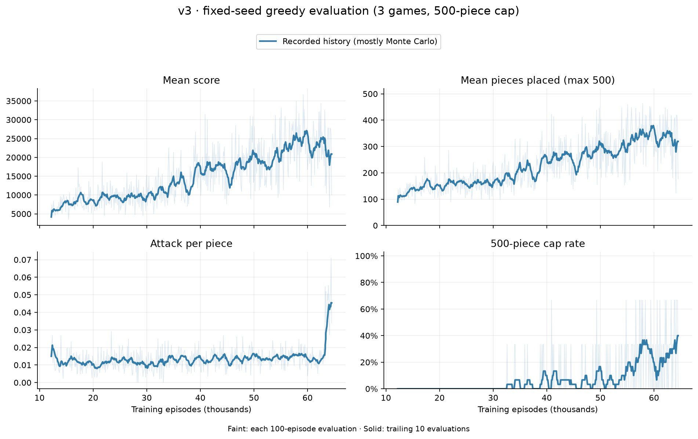
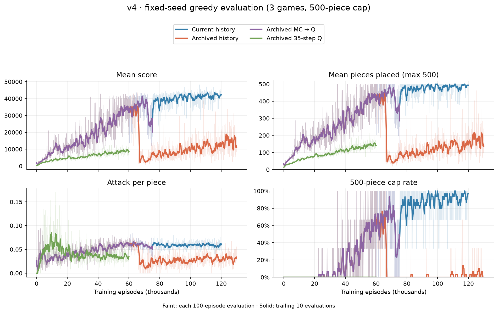
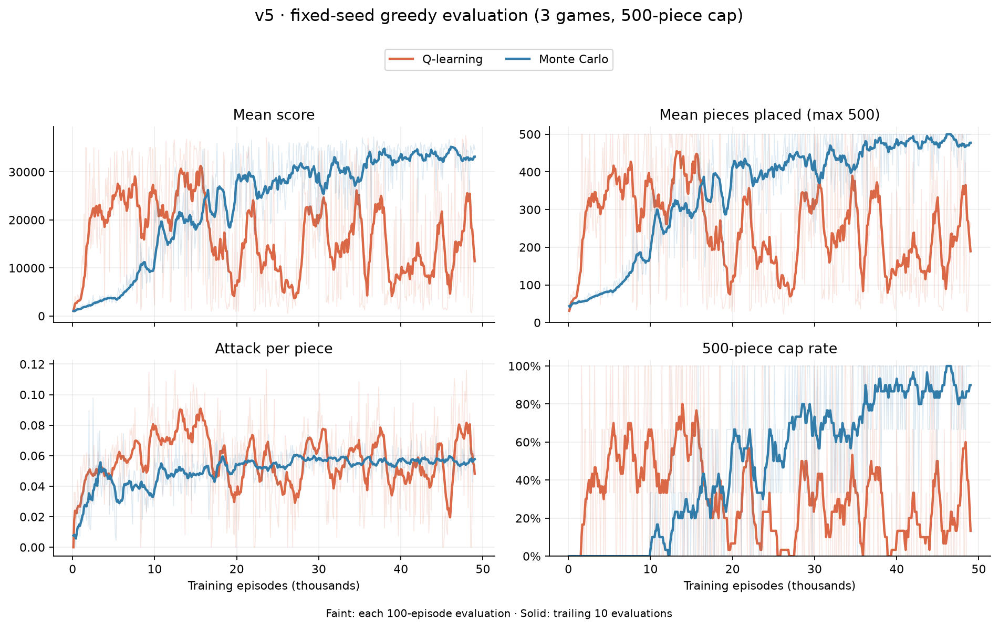
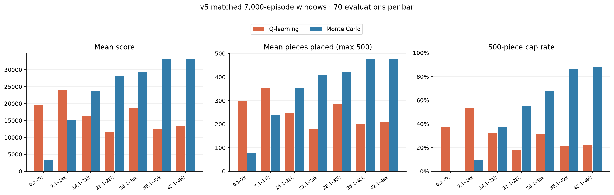

# Tetris AI: evaluation findings

This repository contains a [Tetris engine and Qt game](tetris_engine/README.md) and
a [placement-scoring AI](tetris_ai/train.py). Saved evaluations cover three
encoding versions and several archived training runs. The clearest
within-encoding finding is in v5: Q-learning looked promising around 15k
episodes but lost survival performance later; Monte Carlo was substantially
stronger over the final 42.1k–49k window.

## All encoding histories

These plots include **every distinct saved evaluation history** across v3,
v4, and v5. Archived v4 logs are separate runs, **not** continuations of the
current v4 log. The archived v5 `49k_evals_35stepsqlearning.jsonl` is
byte-for-byte identical to the current v5 Q-learning log, so it is drawn only
once.

At the same **42.1k–49k** episode range (70 evaluations each), the main
histories and v5 Monte Carlo archive look like this:

| History | Mean score | Mean pieces | Mean attack | Attack/piece | 500-piece cap rate |
| --- | ---: | ---: | ---: | ---: | ---: |
| v3 recorded | 17,218 | 261 | 3.6 | 0.013 | 4% |
| v4 current | 23,066 | 314 | 16.8 | 0.052 | 22% |
| v5 Q-learning | 13,453 | 208 | 15.5 | 0.055 | 22% |
| v5 Monte Carlo | 33,316 | 479 | 27.0 | 0.057 | 88% |

This is a **descriptive checkpoint comparison**, not a controlled test of
encoding: the model, training histories, and methods differ. In particular,
the v5 Q-learning row should not be taken as proof that v5 encoding is worse
than v4.

### v3



The recorded v3 history starts at **12.2k** episodes and ends at **64.5k**;
it is mostly labeled Monte Carlo, with one behaviour-cloning entry at 63,302.
Its last checkpoint averaged **9,992 score, 177 pieces, and 0/3 caps**.
Because the early history is absent, this is not a start-to-finish training
curve.

### v4



The current v4 history extends to **120k** episodes; its last checkpoint
averaged **42,212 score and 500 pieces (3/3 caps)**. The archived v4 histories
vary substantially, even at similar episode counts. One archived Monte Carlo
run ends with three Q-learning evaluations at 75.1k–75.3k, so its endpoint
should **not** be described as a Monte Carlo endpoint. The initial
behaviour-cloning entries in several logs are likewise retained as logged.
These histories show that the encoding version alone does not determine the
outcome; they are not a controlled encoding ablation.

### v5



## v5 method comparison and measurement

Each logged evaluation is greedy model inference on seeds `987654321`,
`987654322`, and `987654323`, with a **500-piece cap per game**. The two v5
histories have 490 aligned evaluations at 100-episode intervals (100–49,000
episodes); the earlier histories differ in length and some include extra
early entries. These are clean openings, not the optional seeded training
spin/garbage setups. Each chart shows raw evaluations faintly and a trailing
**10-evaluation** mean in solid color. They reflect the logged greedy policy,
**not** the newer two-ply Qt search or human-versus-bot play.

The cap rate is the fraction of those three games that reached 500 pieces;
it is not a win rate. Attack per piece is total attack divided by total pieces
placed across the three games, so a high value does not imply long survival.
Window figures below average the logged per-evaluation metrics, rather than
pooling all games into one ratio.



The v5 window chart covers **all 49k episodes** in seven consecutive,
equal-sized blocks: each bar averages **70 evaluations over 7,000 training
episodes**. For reference, three of those blocks are tabulated below:

| Evaluation window | Method | Mean score | Mean pieces | Mean attack | Attack/piece | 500-piece cap rate |
| --- | --- | ---: | ---: | ---: | ---: | ---: |
| 7.1k–14k (70 evals) | Q-learning | 23,920 | 353 | 28.0 | 0.071 | 53% |
| 7.1k–14k (70 evals) | Monte Carlo | 15,170 | 240 | 11.5 | 0.045 | 10% |
| 14.1k–21k (70 evals) | Q-learning | 16,198 | 248 | 19.0 | 0.059 | 32% |
| 14.1k–21k (70 evals) | Monte Carlo | 23,697 | 355 | 18.9 | 0.051 | 38% |
| 42.1k–49k (70 evals) | Q-learning | 13,453 | 208 | 15.5 | 0.055 | 22% |
| 42.1k–49k (70 evals) | Monte Carlo | 33,316 | 479 | 27.0 | 0.057 | 88% |

At exactly **49k**, Q-learning averaged 15,379 score and 264 pieces and
reached the cap on **0/3** seeds. Monte Carlo averaged 34,707 score and
**500 pieces (3/3 caps)**. The Q-learning decline after its early strong
window is primarily a survival problem: late attack per piece is close to
Monte Carlo's, but its games end much sooner. On this benchmark, the saved
`49k_model_monte_carlo.pt` is the better-supported v5 opponent than the
Q-learning `latest.pt`.

## Scope and limitations

- These are **three fixed seeds reused at every checkpoint**. Window averages
  show training trends, not independent test games or statistical confidence
  intervals. More held-out seeds and direct Qt matches are needed to establish
  general performance.
- The two v5 methods share the encoding and evaluation settings. v3/v4 use
  different encodings and training histories; their plots are descriptive,
  **not** evidence that one encoding is better in isolation. Comparing v4 at
  120k with v5 at 49k would also confound training duration.
- The logs record outcomes, not the cause of Q-learning's regression. They do
  not establish that Monte Carlo always outperforms Q-learning.

## Reproduce the images

The input logs are local training artifacts (ignored by Git) under
`tetris_ai/checkpoints/encoding_v{3,4,5}/shared/`. The script reads each
version's `evaluations.jsonl`, the three `old_*evaluations.jsonl` archives
for v4, and `49k_evals_monte_carlo.jsonl` for v5. With those files present
and `matplotlib` installed, run:

```sh
python tetris_ai/plot_evaluations.py
```

This regenerates the committed PNGs in [`imgs/`](imgs/). The plots are a
snapshot of the saved logs; rerun the script if the logs change.
